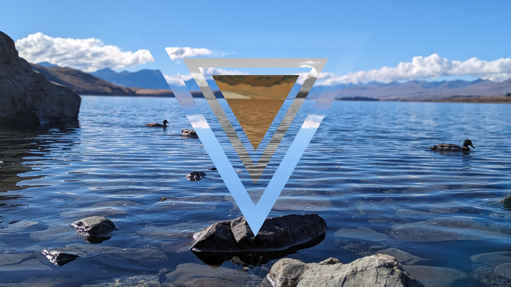
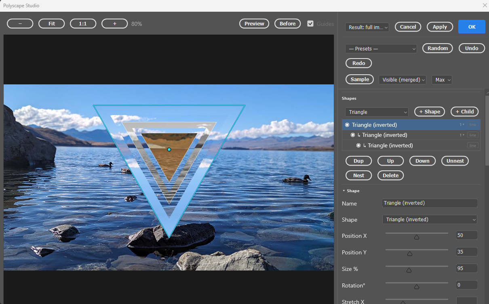
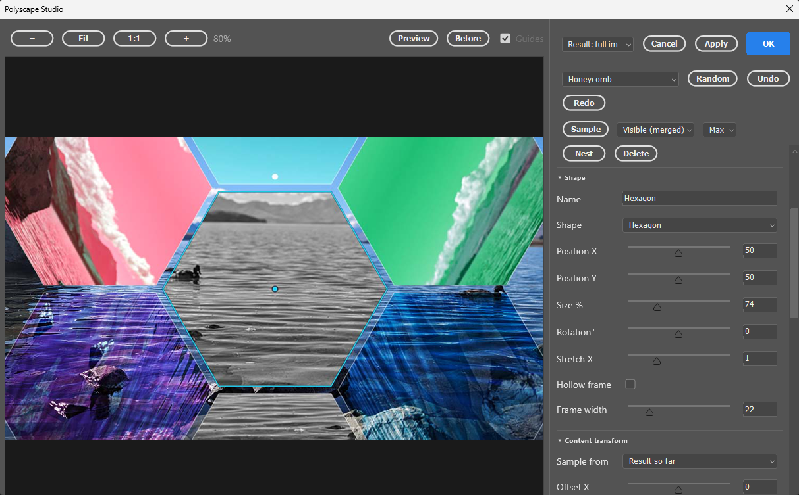

# Polyscape Studio

A Photoshop plugin for **polyscaping**: put geometric shapes on a photo and transform whatever sits inside each one — mirror it, flip it, rotate it, recolour it, blend it — with shapes nested inside other shapes.

Everything is previewed live in one dialog, and the result is added to your document as a new layer, so the original is never touched.

*Three nested inverted triangles: each one flips and recolours the picture inside it.*

## What you get

A dialog with a large live preview on the left and the controls on the right. Drag shapes on the preview to place them, nest shapes inside each other, and adjust each one's content, colour and blending.

*Building the design above: three nested triangles in the shape list, with the selected shape's settings below.*

*The built-in Honeycomb preset — one of 20 starting points. Press Random for a new design every time.*

- **43 shapes** — polygons, stars, circles, rings, crescents, hearts, gears and more — that can be nested inside each other.
- **Content transforms** inside each shape: flip, mirror, rotate, zoom, kaleidoscope, twirl, pixelate, blur, RGB split.
- **Colour filters**: greyscale, invert, sepia, hue shift, duotone, tint, posterize, threshold, grain and more.
- **24 blend modes**, gradient/glass overlay, outline, shadow/glow and repeat (echo) copies.
- **20 built-in presets**, a randomiser, and your own saved presets.
- The result goes on a **new layer** — either the full image or just the shapes on a transparent layer.

## Install

1. Download `PolyscapeStudio-<version>-Installer.zip` from the [latest release](https://github.com/Claxon/polyscape-studio/releases/latest) and unzip it.
2. Double-click **Install Polyscape Studio.cmd**.
3. Restart Photoshop.

Requires Photoshop 2023 (24.4) or later on Windows, signed in to Creative Cloud. Uninstall with **Uninstall Polyscape Studio.cmd**.

## Quick start

1. Open an RGB image in Photoshop.
2. Choose **Plugins › Polyscape Studio › Open Polyscape Studio…**
3. Pick a design from **Presets**, or press **Random**.
4. Drag shapes on the preview to place them; tweak them in the controls on the right.
5. Press **OK** to add the result as a new *Polyscape* layer.

## Documentation

- [User guide](docs/user-guide.md) — the dialog, shapes, every setting, presets and troubleshooting.
- [Development](docs/development.md) — project layout, running the UI in a browser, building and releasing.
- [Changelog](CHANGELOG.md)

## License

[MIT](LICENSE) © 2026 Nova Reaction Limited. This covers the code, the documentation and the images in this repository.
