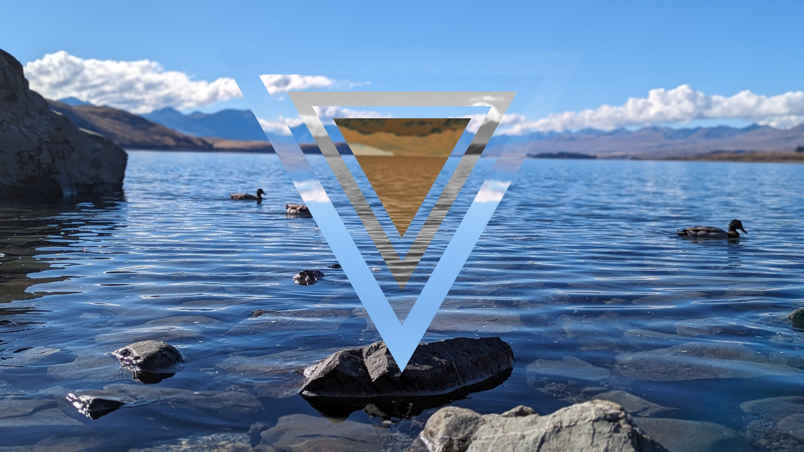
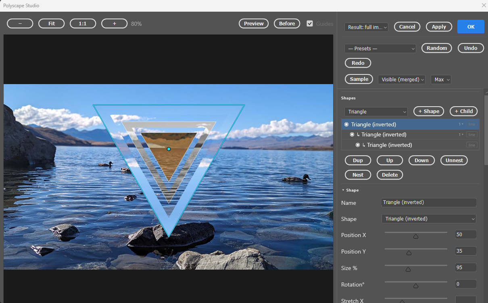
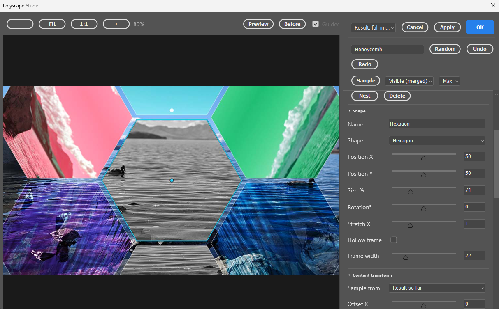

# Polyscape Studio — User guide

Polyscape Studio places geometric shapes on an image and changes what is inside each shape. A shape can mirror, flip, rotate or zoom the picture inside it, recolour it, blur or pixelate it, and blend it back onto the image. Shapes can contain child shapes, which move with their parent and are clipped to it, so you can build up layered designs.

The plugin never changes your existing layers. **Apply** and **OK** add the result as a new layer named *Polyscape*.

*A finished result: three nested inverted triangles. The outer one shows the sky flipped down over the water; the inner ones turn their content grey and a posterized amber.*

## Requirements

- Photoshop 2023 (24.4) or later on Windows, signed in to Creative Cloud.
- An **RGB** document, 8 or 16 bits per channel. CMYK, Lab, greyscale, indexed and 32-bit documents are not supported — convert with *Image › Mode* first.

## Installing and uninstalling

1. Download `PolyscapeStudio-<version>-Installer.zip` from the [releases page](https://github.com/Claxon/polyscape-studio/releases) and unzip it anywhere.
2. Double-click **Install Polyscape Studio.cmd**. It installs the plugin with Adobe's own plugin installer.
3. Restart Photoshop.

To update, install the newer version the same way. To remove the plugin, run **Uninstall Polyscape Studio.cmd** and restart Photoshop.

`PolyscapeStudio.ccx` in the release is the raw plugin package; double-clicking it installs it through Creative Cloud instead.

## Opening the dialog

Open an image, then choose **Plugins › Polyscape Studio › Open Polyscape Studio…**

The dialog samples the document when it opens. The preview is on the left and the controls are on the right. Drag the dialog edge to resize it; the size is remembered for next time (it is always kept within the screen).

*The dialog while building the design above. The selected shape has a blue outline and a white rotation dot on the preview, and is highlighted in the shape list.*

## The controls column

From the top:

| Control | What it does |
| --- | --- |
| **Result** | *Full image* puts the whole finished picture on the new layer. *Shapes only* puts just the shapes' content on a transparent layer, so you can mask or blend it yourself. |
| **Cancel** | Closes the dialog without changing the document. Your design is kept for next time. |
| **Apply** | Adds the result as a new *Polyscape* layer, then reopens the dialog with a fresh sample, so you can keep building on top of it. |
| **OK** | Adds the result as a new layer and closes. |
| **Presets** | Loads one of the 20 built-in designs, or one of your saved ★ presets. |
| **Random** | Generates a random design. Press it again for another. |
| **Undo / Redo** | Steps back and forward through your changes. |
| **Sample** | Re-reads the document, for example after you have edited it in Photoshop. |
| **Visible (merged) / Active layer** | What to sample: everything you can see, or just the selected layer. |
| **Fast / Normal / Sharp / Max** | Preview resolution. Higher is sharper but slower. The final result is always rendered at full resolution. |

Below these are the **Shapes** list, the settings for the selected shape, and **My presets**. Scroll the column with the mouse wheel.

## The preview

| Action | How |
| --- | --- |
| Select a shape | Click it. |
| Move a shape | Drag it. |
| Scale a shape | Shift + drag up or down. |
| Rotate a shape | Drag the white dot, or Alt + drag. Hold Shift to snap to 15°. |
| Pan | Drag an empty area, or right-drag anywhere. |
| Zoom | Mouse wheel over the image, or the **− / Fit / 1:1 / +** buttons. You can zoom out past *Fit*. |
| Compare | **Preview** shows the clean result without guides; **Before** shows the original. Click again to return to editing. |
| Guides | Untick **Guides** to hide the shape outlines while editing. |

Shape outlines on the preview are guides only; they are not drawn into the result unless you turn on the shape's outline (see below).

## Shapes

### Adding and arranging

- Choose a shape type and press **+ Shape** to add it at the top level, or **+ Child** to add it inside the selected shape.
- **Dup** duplicates the selected shape with its children. **Delete** removes it.
- **Up / Down** change the drawing order. Shapes higher in the list are drawn later, on top.
- **Nest** makes the selected shape a child of the shape above it; **Unnest** moves it out of its parent. The shape stays where it is on the image.
- In the list, **◉** toggles a shape's visibility and **line** toggles whether its outline is drawn into the final image.

Child shapes are positioned relative to their parent: they move, scale and rotate with it, and are clipped to it unless you turn off *Clip to parent*.

### Shape types

43 shapes are available: triangle, inverted triangle, right triangle, tall triangle, square, rectangle, diamond, rhombus, parallelogram, trapezoid, kite, pentagon, two hexagons, heptagon, octagon, n-sided polygon, star, pentagram, starburst, 4-point sparkle, hexagram, octagram, compass star, circle, ellipse, ring, semicircle, pie wedge, crescent, lens, squircle, flower, heart, teardrop, shield, cross, X cross, chevron, arrow, lightning bolt, bar and gear. Several have extra settings, such as the number of points or the thickness, which appear in the *Shape* section.

## Shape settings

Click a section heading to open or close it. Double-click a setting's name to reset it to its default.

**Shape** — name, type and type-specific settings; position, size, rotation and horizontal stretch; *Hollow frame* turns the shape into a frame of the given width.

**Content transform** — what the shape shows:
- *Sample from*: the result so far (so shapes can transform each other) or the original image.
- *Offset X / Y*, *Rotate*, *Zoom*: move, turn and scale the picture inside the shape.
- *Flip horizontal / vertical*, *Mirror half* (left, right, top, bottom or four-way).
- *Kaleidoscope* (number of segments), *Twirl*, *Pixelate*, *Blur*, *RGB split*.
- *Edges*: what fills in past the image edge — mirrored, stretched or tiled.

**Colour filters** — brightness, contrast, saturation, hue shift, greyscale, sepia, invert, posterize, threshold, grain, tint (with colour) and duotone (with shadow and highlight colours).

**Gradient / glass overlay** — a colour gradient over the shape, with start and end opacity and direction.

**Blending** — 24 blend modes (Normal, Multiply, Screen, Overlay, Soft/Hard/Vivid/Linear/Pin Light, Hard Mix, Darken, Lighten, Colour Dodge/Burn, Linear Burn, Add, Subtract, Divide, Difference, Exclusion, Hue, Saturation, Colour, Luminosity), opacity, and *Clip to parent*.

**Outline** — *Draw in result* adds the shape's outline to the final image, with width, colour, opacity and position (centre, inside, outside). Off by default: shapes are templates.

**Shadow / glow** — opacity, colour, softness and offset. A zero offset with a light colour gives a glow.

**Repeat (echo)** — draws extra copies of the shape, each scaled, rotated and shifted from the last, for tunnel and spiral effects.

Colours are entered as hex (`#ff8800`). Clicking the swatch cycles through a handy palette.

## Presets

*The built-in Honeycomb preset applied to the same photo.*

- **Built-in**: 20 designs to start from — pick one from the *Presets* menu.
- **Your own**: type a name under *My presets* and press **Save**. Saved presets appear in the *Presets* menu with a ★. Saving with an existing name replaces it. To delete one, select it in the *Presets* menu and press **Delete** under *My presets*.

Your current design is saved automatically and is still there the next time you open the dialog.

## Troubleshooting

**"No open document" or "Document must be RGB"** — open an RGB image (*Image › Mode › RGB Color*) and open the dialog again.

**The dialog is too big or too small** — drag its edge to resize it; the new size is remembered.

**The preview is slow** — choose *Fast* or *Normal* preview resolution. This doesn't affect the quality of the result.

**Apply takes a while on big images** — the result is rendered at full resolution; very large documents can take several seconds.

**Something else went wrong** — the plugin writes a diagnostic log to
`%APPDATA%\Adobe\UXP\PluginsStorage\PHSP\<version>\External\com.claxo.polyscapestudio\PluginData\polyscape-log.txt`.
Include it when [reporting a problem](https://github.com/Claxon/polyscape-studio/issues).
